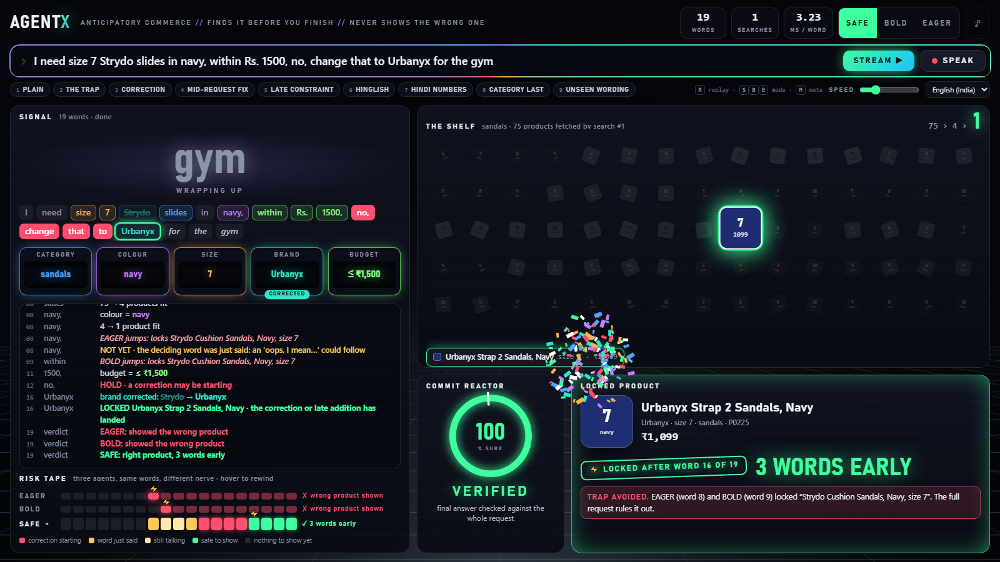

# AgentX · Anticipatory Commerce

**Techfest IIT Bombay 2026–27, AgentX Challenge 1.** A shopping agent that reads a request one
word at a time, predicts the shopper's filters, fetches the right shelf with one search and
shows the product **before the shopper finishes**, without ever committing to a wrong one.

```
"I need black size 9 UK floaters by Strydo less than 0.8k ⚡ for the gym"
                                                           └─ shown here: P0206, 2 words early
```

## Results (official `kit/evaluate.py`)

| Set (300 requests each) | Score | Accuracy | Wrong commits | Earliness | Searches/req |
|---|---|---|---|---|---|
| `dev.jsonl`, **safe mode (default)** | **45.2** (baseline 20.0) | **100%** (baseline 52.7%) | **0** | 8.6% | 1.00 |
| `dev.jsonl`, bold mode | 46.1 | 100% | 2 | 11.5% | 1.04 |
| Unseen wording (stress, generated) | 45.3 (baseline 9.0) | 100% | 0 | 8.9% | 1.01 |
| Gibberish words (stress, generated) | 28.4 (baseline 13.6) | 67% | 0 | 2.7% | 1.00 |

Robustness on dev, by request type:

| Request type | Requests | Accuracy | Wrong commits | Earliness | Score |
|---|---|---|---|---|---|
| Corrections ("black, no wait, white") | 55 | 100% | 0 | 13.1% | 47.8 |
| Late constraints ("oh, and in blue") | 50 | 100% | 0 | 10.7% | 46.4 |
| Hindi–English | 25 | 100% | 0 | 8.4% | 45.1 |
| Plain | 177 | 100% | 0 | 7.1% | 44.3 |

Filters reported at the last word are 1.00 on all five fields. The whole dev run uses 301
searches for 300 requests. The agent itself needs about 0.3 ms per word (3.6 ms per request),
with no model calls, no network and no dependencies. Outputs are in [outputs/](outputs/):
`dev_results.jsonl` is the `--log` of the default run and `dev_score.txt` is its printout.

## Run it

Python 3.9+, standard library only, nothing to install.

```bash
python kit/evaluate.py --agent agent.py                          # score on dev.jsonl
python kit/evaluate.py --agent agent.py --log outputs/dev_results.jsonl
AGENTX_MODE=bold python kit/evaluate.py --agent agent.py         # earlier, small measured risk
AGENTX_MAX_WASTED_SEARCHES=0 python kit/evaluate.py --agent agent.py   # exactly 1 search/request
python demo/cli.py dev-0040                                      # watch one request word by word
python demo/server.py                                            # live demo: http://localhost:8765
python -m unittest discover -s tests -v                          # 18 unit tests
```

On Windows PowerShell, set variables with `$env:AGENTX_MODE="bold"` first.

## Live demo



`python demo/server.py` serves a console that runs the real agent word by word. Type a request,
pick a sample (keys `1`–`9`) or press SPEAK to use the browser's speech-to-text.

- **Signal**: the word just heard and what it means ("floaters → SANDALS"), five filter reels,
  and a plain-language log of every decision.
- **The shelf**: every product the one search fetched; tiles drop out as words arrive.
- **Commit reactor**: the confidence and the threshold it must cross.
- **Risk tape**: three copies of the agent race on the same words, differing only in the
  commit threshold. EAGER locks the instant one product fits, BOLD waits one word, SAFE is the
  default. In the screenshot the shopper corrected the brand late: EAGER and BOLD had already
  shown the wrong sandal, and SAFE held, then locked the right one three words early.

Hover the tape to rewind the whole screen to any word. The console is a fixed 16:9 stage
that scales to the window, so it fits any screen. Shot list for the video:
[docs/DEMO_SCRIPT.md](docs/DEMO_SCRIPT.md).

## How it works

Full note: [docs/ARCHITECTURE.md](docs/ARCHITECTURE.md).

1. **Understand the prefix** ([anticipate/nlu.py](anticipate/nlu.py),
   [anticipate/lexicon.py](anticipate/lexicon.py)). A phrase trie built from the catalogue's own
   values plus a curated synonym layer in English, Indian English and romanised Hindi ("floaters",
   "lowers", "kaala", "das number"). A number grammar reads "0.8k", "forty five hundred" and
   "saadhe teen hazaar". The whole prefix is re-read on every word, so a slot is always its
   *last* mention and corrections need no special case. The parser also reports what is **not
   settled yet**: a number still growing ("under two…"), a phrase that may change meaning
   ("denim…" → "denim jacket"), a half-said correction, or a word that may start one
   ("I…" → "I mean").
2. **Walk to the shelf** ([anticipate/shelf.py](anticipate/shelf.py)). As soon as the category
   is known, one counted search fetches that whole shelf (at most 89 products). Later words
   narrow it locally at no search cost. A search that would overflow one page is skipped until
   another filter arrives.
3. **Commit only when it is safe** ([anticipate/policy.py](anticipate/policy.py)). Once a
   product is the only match, a late addition can never move it; only a correction can. So the
   confidence of a commit is the chance that no correction is still coming. That depends on
   where the shopper is in the request, and the error rate of each state was measured on dev:

   | state | meaning | wrong / seen on dev |
   |---|---|---|
   | unsettled | a correction is half-said | 21 / 29 |
   | at-value | the deciding word was just said | 18 / 194 |
   | past-value | one word later, request still going | 2 / 48 |
   | tail | past the filters ("for my dad", "thanks") | 0 / 121 |
   | twist-done | the correction or late addition has landed | 0 / 99 |

   `confidence = (1 − risk(state)) / #matching products`. Safe mode commits when it is
   ≥ 0.99, i.e. only in the zero-error states. Bold mode (≥ 0.94) also commits mid-request.
4. **Check against the full request** in `finish()`: re-read everything, answer from the
   shelf, and relax the least-trusted filter if nothing matches.

## Requirements coverage

| Must have | Where |
|---|---|
| Filter prediction from a partial request + confidence that decides commit/wait | `nlu.py`, `policy.py`; `observe()` returns `{"filters", "confidence", "commit"}` every word |
| Early searches, checked against the full request before the answer is final | `shelf.py` (early shelf fetch), `Agent.finish()` |
| Mid-request corrections and late constraints | last-mention-wins + correction states; 100% / 0 wrong on both tags |

| Stretch goal | Where |
|---|---|
| Hindi–English code-mixed requests | Hindi numbers, colours, sizes and markers in `lexicon.py`; 25/25 on dev |
| Voice demo with any speech-to-text | `demo/index.html` (browser speech-to-text streaming into the real agent) |
| Tunable limit on wasted searches | `AGENTX_MAX_WASTED_SEARCHES` (default 3). At 0 the agent uses exactly one search per request and still scores 45.2 on dev |

## Design decisions

* **Products only through counted searches.** `catalogue.csv` is read at start-up for
  vocabulary (canonical values) and store-level statistics (how many products each category
  or brand has, used to size a search). Products themselves only arrive through
  `tools.search`. One search returns one page of up to 100 results.
* **No external services.** The agent makes no network calls. Every search is the kit's local
  search, counted by the evaluator.
* **Safe by default.** Bold mode scores about one point more on dev but makes 2 wrong commits,
  both on correction requests. The brief asks for zero wrong commits, so safe is the default.
* **Deterministic, no LLM at run time.** That gives sub-millisecond latency, no per-request
  cost and reproducible scores. The robustness to new wording comes from a broad lexicon and
  from knowing when not to commit, and it is measured on generated stress sets
  (`tools/make_stress.py`).

## Starter kit version

`kit/` is the organisers' updated starter kit of 21 November 2026
(`ps1-anticipatory-commerce-no-rezolve.zip`), unmodified. Compared with the first release it
changes only the kit README and one docstring in `evaluate.py`; the catalogue, dev set, search
function and scoring are identical.

## Repository layout

```
agent.py              Agent class loaded by kit/evaluate.py
anticipate/           lexicon.py · nlu.py · shelf.py · policy.py
kit/                  official starter kit, unmodified
demo/                 cli.py (terminal trace) · server.py + index.html (live console, voice)
tools/                calibrate.py (risk table) · policy_lab.py · make_stress.py ·
                      check_parse.py · simulate.py
tests/                unit tests
outputs/              dev and stress-set results and printouts
docs/                 ARCHITECTURE.md · ABSTRACT.md · DEMO_SCRIPT.md · SUBMISSION_CHECKLIST.md · img/
```

Reproduce every number: `python tools/make_stress.py`, then the evaluate commands above, plus
`python tools/calibrate.py` for the risk table.
